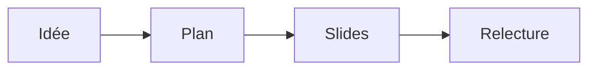
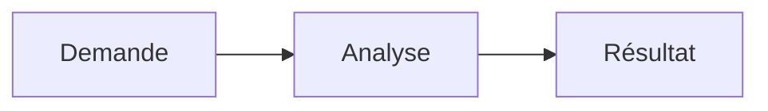

# Catalogue Slidev

Des exemples à essayer, adapter et combiner selon le sujet.

Flèches du clavier : clic suivant / précédent · O : vue d’ensemble

<!--
Ce catalogue est une boîte à outils. Une présentation finale n'a pas besoin d'utiliser toutes ces fonctionnalités.
-->

---
layout: default
---

# Sommaire

<Toc columns="3" class="text-sm" />

---
layout: default
---

# Révéler progressivement

<v-clicks>

- Poser le contexte.
- Montrer les éléments un par un.
- Faire apparaître la conclusion.

</v-clicks>

<div v-after class="mt-4 text-sky-600 deck-accent-text">Ce texte apparaît au même clic que la conclusion.</div>

---
layout: default
---

# Faire apparaître et remplacer

<p v-click="[1, 3]">Cette explication est visible aux clics 1 et 2, puis disparaît.</p>

<v-switch>
  <template #1><div class="rounded bg-sky-100 text-slate-900 deck-panel p-5">Étape 1 · Observer</div></template>
  <template #2><div class="rounded bg-sky-100 text-slate-900 deck-panel p-5">Étape 2 · Comprendre</div></template>
  <template #3><div class="rounded bg-sky-100 text-slate-900 deck-panel p-5">Étape 3 · Agir</div></template>
</v-switch>

---
layout: default
clicks: 2
---

# Déplacer pour expliquer

<div class="mt-16 flex items-center gap-14">
  <div v-motion :initial="{ x: -50, opacity: 0 }" :enter="{ x: 0, opacity: 1 }" :click-1="{ x: 100 }" :click-2="{ x: 200 }" class="rounded bg-sky-600 deck-accent-block px-5 py-3 text-white">Une idée</div>
</div>

<p class="mt-28 opacity-70">Avancer dans la slide pour déplacer l’objet à chaque étape.</p>

---
layout: default
transition: slide-left
---

# Transitions entre slides

Cette slide utilise `slide-left` pour rejoindre la suivante.

Les transitions peuvent être définies globalement ou par slide.

---
layout: default
transition: view-transition
---

# View Transition · avant

<div style="view-transition-name: catalogue-card" class="mt-12 w-48 rounded bg-sky-600 deck-accent-block p-6 text-white">Une idée</div>

<p class="mt-8 opacity-70">La slide suivante réutilise le même nom pour relier les deux états.</p>

---
layout: default
---

# View Transition · après

<div style="view-transition-name: catalogue-card" class="mt-12 ml-80 w-80 rounded bg-sky-600 deck-accent-block p-6 text-white">Une idée devient un projet</div>

<p class="mt-8 opacity-70">Effet expérimental, selon le navigateur.</p>

---
layout: default
dragPos:
  caption: 65,376,707,75
  badge: 517,163,307,118
---

# Déplacer une carte

Double-cliquez un objet pour le sélectionner, puis déplacez-le ou redimensionnez-le.

<div v-drag="'badge'" class="rounded bg-amber-200 deck-panel p-4 text-slate-900">Directive v-drag</div>

<v-drag pos="caption">
  <div class="rounded-xl bg-sky-700 deck-accent-block text-white p-5 shadow-lg text-center">Conteneur déplaçable</div>
</v-drag>

---
layout: default
dragPos:
  flow: 133,175,640,126
---

# Déplacer une architecture

Le diagramme entier est un seul objet. Double-cliquez pour l’ajuster.

<v-drag pos="flow">



</v-drag>

---
layout: default
dragPos:
  connection: 302,175,330,-3
---

# Flèches et connexions

<div class="mt-20 flex justify-around text-xl"><span>Source</span><span>Destination</span></div>

<Arrow x1="220" y1="275" x2="570" y2="275" color="#0284c7" />
<v-drag-arrow pos="connection" color="#f97316" />

<p class="mt-24 opacity-70">Bleu : flèche fixe · orange : double-cliquez pour ajuster la connexion.</p>

---
layout: default
---

# Annotations automatiques

<p class="mt-12 text-3xl">Une idée <span v-mark.underline.orange="1">importante</span> puis une <span v-mark.circle.blue="2">décision</span>.</p>

<p class="mt-12 opacity-70">Avancez pour dessiner les marques au fil de l’explication.</p>

---
layout: default
---

# Dessiner en direct

Utilisez les outils de dessin dans la barre de navigation pour annoter ce schéma.

<div class="mt-16 flex justify-around text-xl"><div class="border rounded p-5">Question</div><div class="border rounded p-5">Réponse</div></div>

<!--
Tester les outils de dessin en mode présentation et leur persistance, puis effacer les annotations de démonstration si nécessaire.
-->

---
layout: default
---

# Expliquer un diagramme progressivement



<div v-click class="mt-6">1. Comprendre la demande.</div>
<div v-click>2. Analyser les possibilités.</div>
<div v-click>3. Présenter le résultat.</div>

---
layout: default
---

# Icônes et encadrés

<div class="mt-12 flex items-center gap-6">
  <div class="i-carbon-lightbulb text-5xl text-amber-500 deck-highlight-icon" aria-hidden="true" />
  <div class="rounded bg-slate-100 deck-panel p-5 text-slate-900">Un encadré fait ressortir une idée sans alourdir la slide.</div>
</div>

---
layout: default
dragPos:
  screenshot: 486,116,446,304
---

# Image et légende déplaçables

Double-cliquez la capture, puis déplacez ou redimensionnez le bloc.

<v-drag pos="screenshot">
  <figure class="m-0 rounded bg-slate-100 deck-panel p-3 shadow text-slate-900">
    
    <figcaption class="text-sm mt-2">Exemple local · remplacez le fichier par votre capture</figcaption>
  </figure>
</v-drag>

---
layout: default
---

# Tableau et formule

| Étape | Durée | Objectif |
| --- | ---: | --- |
| Explorer | 10 min | Comprendre |
| Construire | 20 min | Expérimenter |
| Relire | 5 min | Améliorer |

Une formule KaTeX : $\text{total} = \sum_{i=1}^{n} x_i$

---
layout: default
---

# Lire du code progressivement

```ts {1|2-3|4}
const prices = [12, 8, 5]
const total = prices.reduce((sum, price) =>
  sum + price, 0)
console.log(total)
```

Les clics mettent en évidence les lignes utiles à chaque étape.

---
layout: default
---

# Faire évoluer du code

````md magic-move
```js
const total = prices => prices.length
```
```js
const total = prices => prices.reduce((sum, price) => sum + price, 0)
```
````

---
layout: default
---

# Modifier et exécuter

```ts {monaco-run} {autorun:false}
const price = 12
const quantity = 3
console.log(price * quantity)
```

Modifiez les valeurs puis lancez l’exécution avec le bouton de lecture.

---
layout: default
dragPos:
  interactive: 80,180,500,240,0
---

# Manipuler un paramètre

Le composant est dans un conteneur déplaçable : essayez le curseur, puis le double-clic.

<v-drag pos="interactive">
  <CounterDemo />
</v-drag>

<!--
Le composant Vue est un exemple de démonstration interactive. Adapter ou retirer selon le sujet.
-->

---
layout: two-cols
---

# Composer une slide

Le layout `two-cols` garde le texte dans le flux normal.

- Une idée principale
- Un exemple associé
- Une mise en page simple

::right::

<div class="mt-24 rounded border p-6">Un visuel ou un exemple prend place dans la deuxième colonne.</div>

---
layout: default
---

# Présenter et exporter

- Mode présentateur : `/presenter/` et notes associées aux slides.
- Vue d’ensemble : touche **O**.
- Site statique : `npm run build`.
- PDF : `npm run export` après installation du navigateur nécessaire.

<!--
Les notes sont visibles dans le mode présentateur, pas dans le contenu principal de la slide.
-->
