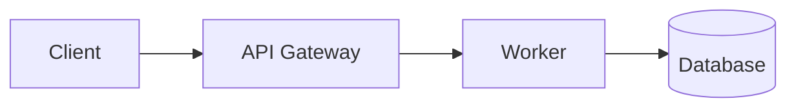

# Slidev Presentation Template

A starting point for interactive, visually editable slides.

  Navigate with the arrow keys.

---
layout: center
---

# Reveal ideas progressively

First: introduce the idea.

Second: show the reasoning.

Third: highlight the conclusion.

---
layout: default
dragPos:
  caption: 540,320,340,110,0
---

# Move an independent element

Double-click the card below to move or resize it in dev mode.

<v-drag pos="caption">
  

    Editable visual card
  

</v-drag>

---
layout: default
---

# Diagram as one entity

The diagram is kept as a single Mermaid definition.

---
layout: center
---

# Ready to customize

Use Markdown, Vue components, animations, drawings and draggable objects.

<!--
Speaker notes live here. Replace this deck with your own content.
-->
